# Class Diagram

Classes, services, components and models of `orthanc-scan-ui`, with their inheritance, composition and dependency-injection relationships. See [application-overview.md](application-overview.md) for how the screens behave.

```mermaid
classDiagram
    direction LR

    namespace ScanAPI {
        class ScanApi {
            <<abstract>>
            +getLotStages()* Observable~LotStagesResponse~
            +postScan(record: ScanRecord)* Observable~ScanResponse~
        }
        class HttpScanApi {
            <<injectable>>
            -http: HttpClient
            +getLotStages() Observable~LotStagesResponse~
            +postScan(record: ScanRecord) Observable~ScanResponse~
        }
        class MockScanApi {
            -scanCount: number
            -accepted: Map by clientId
            +getLotStages() Observable~LotStagesResponse~
            +postScan(record: ScanRecord) Observable~ScanResponse~
        }
        class SimulatedOutageScanApi {
            -settings: TestSettingsService
            -inner: ScanApi
            +getLotStages() Observable~LotStagesResponse~
            +postScan(record: ScanRecord) Observable~ScanResponse~
        }
    }

    namespace Services {
        class ScanQueueService {
            <<injectable>>
            -api: ScanApi
            +scanHistory: WritableSignal~ScanHistoryItem[]~
            -autoRetryStarted: boolean
            +startAutoRetry() void
            +clearSent() void
            +removeScan(clientId: string) void
            +submitScan(scan: ScanRecord) Observable~ScanHistoryItem~
            +resendScan(clientId: string) Observable~ScanHistoryItem~
            +confirmLocation(clientId: string, reason: string) Observable~ScanHistoryItem~
            +dismissMismatch(clientId: string) void
            -runRetryLoop() void
            -retryDue() void
            -send(record: ScanRecord) Observable~ScanHistoryItem~
            -updateItem(clientId: string, patch: ScanHistoryItem) void
            -errorMessage(err: unknown) string
        }
        class SessionService {
            <<injectable>>
            -queue: ScanQueueService
            -session: WritableSignal~SessionData~
            +sessionData: Signal~SessionData~
            +start(data: SessionData) void
            +end() void
        }
        class StageService {
            <<injectable>>
            -api: ScanApi
            +stages: WritableSignal~LotStage[]~
            +loadStages() Observable~LotStage[]~
            +rememberedStage() string
            +rememberStage(id: string) void
            +destinationGroups(stageId: string) DestinationGroup[]
            +findDestination(stageId: string, text: string) DestinationOption
            +destinationLabel(record: ScanRecord) string
            +wipLocationDescription(stageId: string, locationId: string) string
            +stageDescription(id: string) string
            -allowedWipLocations(stage: LotStage, nextStageId: string) WipLocation[]
        }
        class TestSettingsService {
            <<injectable>>
            -outage: WritableSignal~boolean~
            +apiOutage: Signal~boolean~
            +setApiOutage(on: boolean) void
        }
        class scanLotGuard {
            <<function>>
            CanActivateChildFn
        }
    }

    namespace Components {
        class App {
            <<component>>
        }
        class ScanLotShellComponent {
            <<component>>
        }
        class StagePickerComponent {
            <<component>>
            +stageService: StageService
        }
        class StartSessionComponent {
            <<component>>
            +stageService: StageService
            -session: SessionService
            +stage: InputSignal~string~
            +sessionForm: FormGroup
            +onSessionSubmit() void
        }
        class ScanComponent {
            <<component>>
            +stageService: StageService
            +session: SessionService
            +queue: ScanQueueService
            +testSettings: TestSettingsService
            +stage: InputSignal~string~
            +scanForm: FormGroup
            +showSuggestions: WritableSignal~boolean~
            +destinationGroups: Signal~DestinationGroup[]~
            +filteredGroups: DestinationGroup[]
            +confirmingId: WritableSignal~string~
            +correctionReason: FormControl~string~
            -barcode: string
            +onKeydown(event: KeyboardEvent) void
            +selectDestination(option: DestinationOption) void
            +goBackToUsername() void
            +onScanSubmit() void
            +onResend(clientId: string) void
            +startConfirm(clientId: string) void
            +cancelConfirm() void
            +onConfirmLocation(clientId: string) void
            +onNotHere(clientId: string) void
            +historyMessage(record: ScanHistoryItem) string
            -onBarcode(value: string) void
            -armBarcodeTimer() void
        }
        class AdminComponent {
            <<component>>
            +settings: TestSettingsService
            +queue: ScanQueueService
            +stageService: StageService
            +showOutageSwitch: boolean
            +now: WritableSignal~number~
            +counts: Signal
            +formatTime(ms: number) string
            +countdown(item: ScanHistoryItem) string
            +retryNow(clientId: string) void
            +removeScan(clientId: string) void
        }
    }

    namespace Models {
        class ScanRecord {
            <<interface>>
            +clientId: string
            +userName: string
            +currentStage: string
            +lotId: string
            +destinationStage: string
            +destinationWipLocation: string
            +scanType: transitional or informational
            +note: string
            +locationConfirmed: boolean
            +correctionReason: string
        }
        class ScanResponse {
            <<interface>>
            +errorCode: string
            +errorMessage: string
            +recorded: RecordedLocation
        }
        class ScanHistoryItem {
            <<interface>>
            +status: ScanStatus
            +errorMessage: string
            +recorded: RecordedLocation
            +submittedAt: number
            +lastAttemptAt: number
            +attempts: number
            +nextRetryAt: number
        }
        class ScanStatus {
            <<enumeration>>
            pending
            success
            failed
            rejected
            mismatch
        }
        class RecordedLocation {
            <<interface>>
            +stage: string
            +wipLocation: string
            +scannedBy: string
            +scannedAt: string
        }
        class LotStage {
            <<interface>>
            +id: string
            +description: string
            +nextStages: string[]
            +wipLocations: WipLocation[]
            +nextWipLocations: Record by next-stage id
        }
        class WipLocation {
            <<interface>>
            +id: string
            +description: string
        }
        class DestinationGroup {
            <<interface>>
            +label: string
            +options: DestinationOption[]
        }
        class DestinationOption {
            <<interface>>
            +label: string
            +destinationStage: string
            +destinationWipLocation: string
            +scanType: transitional or informational
        }
        class SessionData {
            <<interface>>
            +userName: string
            +currentStage: string
        }
        class LotStagesResponse {
            <<type>>
            Record by stage id
        }
    }

    %% Inheritance
    ScanApi <|-- HttpScanApi
    ScanApi <|-- MockScanApi
    ScanApi <|-- SimulatedOutageScanApi
    ScanRecord <|-- ScanResponse
    ScanRecord <|-- ScanHistoryItem

    %% Composition / aggregation
    SimulatedOutageScanApi o-- ScanApi : wraps inner
    LotStage *-- WipLocation
    DestinationGroup *-- DestinationOption
    ScanHistoryItem --> ScanStatus
    ScanHistoryItem --> RecordedLocation
    ScanResponse --> RecordedLocation

    %% Dependency injection
    SimulatedOutageScanApi ..> TestSettingsService : inject
    ScanQueueService ..> ScanApi : inject
    StageService ..> ScanApi : inject
    SessionService ..> ScanQueueService : inject
    scanLotGuard ..> SessionService : inject
    scanLotGuard ..> StageService : inject
    ScanLotShellComponent ..> ScanQueueService : inject
    StagePickerComponent ..> StageService : inject
    StartSessionComponent ..> StageService : inject
    StartSessionComponent ..> SessionService : inject
    ScanComponent ..> StageService : inject
    ScanComponent ..> SessionService : inject
    ScanComponent ..> ScanQueueService : inject
    ScanComponent ..> TestSettingsService : inject
    AdminComponent ..> TestSettingsService : inject
    AdminComponent ..> ScanQueueService : inject
    AdminComponent ..> StageService : inject

    %% Model usage
    ScanApi ..> LotStagesResponse
    ScanApi ..> ScanResponse
    ScanQueueService ..> ScanHistoryItem
    StageService ..> LotStage
    StageService ..> DestinationGroup
    SessionService ..> SessionData
```

## Notes

- **ScanApi wiring is chosen at build time.** `src/environments/scan-api.provider.ts` (dev) provides a `SimulatedOutageScanApi` that wraps either `MockScanApi` (when `useMockApi` is on) or `HttpScanApi`. `scan-api.provider.prod.ts` (production, swapped in by `angular.json`) provides `HttpScanApi` directly, so the mock and the outage simulation never ship.
- **`SimulatedOutageScanApi` is a decorator.** It extends `ScanApi` and also wraps another `ScanApi`. While the admin outage switch (`TestSettingsService.apiOutage`) is on, `postScan` fails the way a network outage would. Otherwise it passes every call through to the wrapped API.
- **Routing:** `App` hosts the router. `/scan-lot` renders `ScanLotShellComponent`, and its children are `StagePickerComponent` (`''`), `StartSessionComponent` (`:stage`) and `ScanComponent` (`:stage/scan`). `scanLotGuard` guards all three. `/admin` renders `AdminComponent`.
- **Stereotypes:** `<<injectable>>` is an Angular service provided in root. `<<component>>` is an Angular standalone component. `<<interface>>` / `<<type>>` / `<<enumeration>>` are TypeScript model types from `scan-lot.models.ts`. `<<function>>` is a functional route guard, not a class.
- Optional (`?`) fields are drawn as plain fields. Signal and Observable types are simplified.
