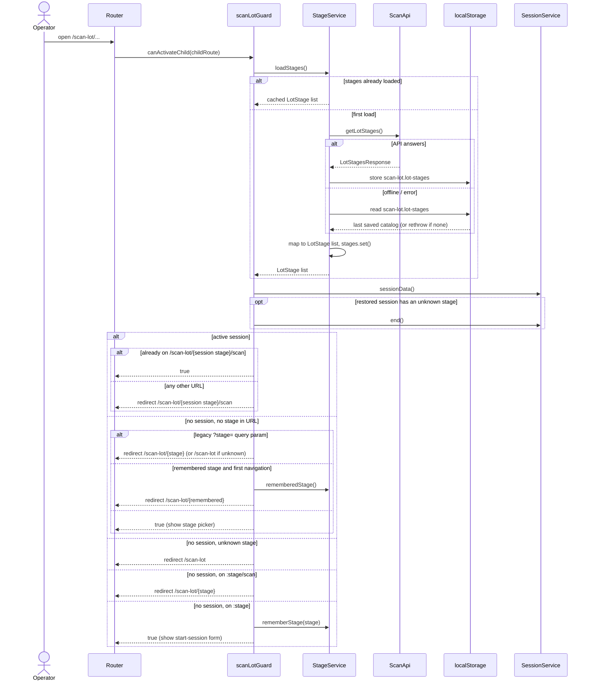
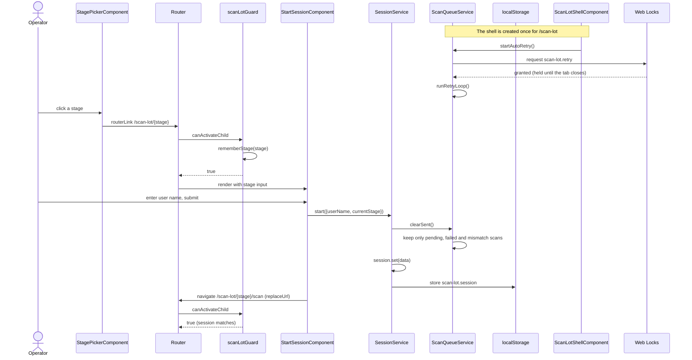
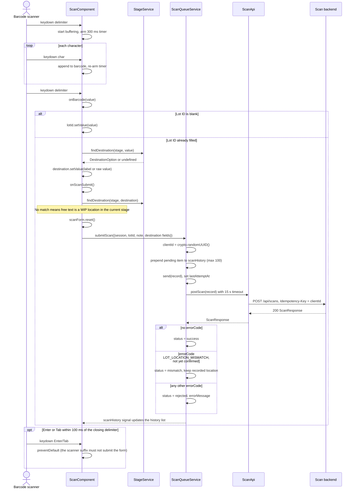
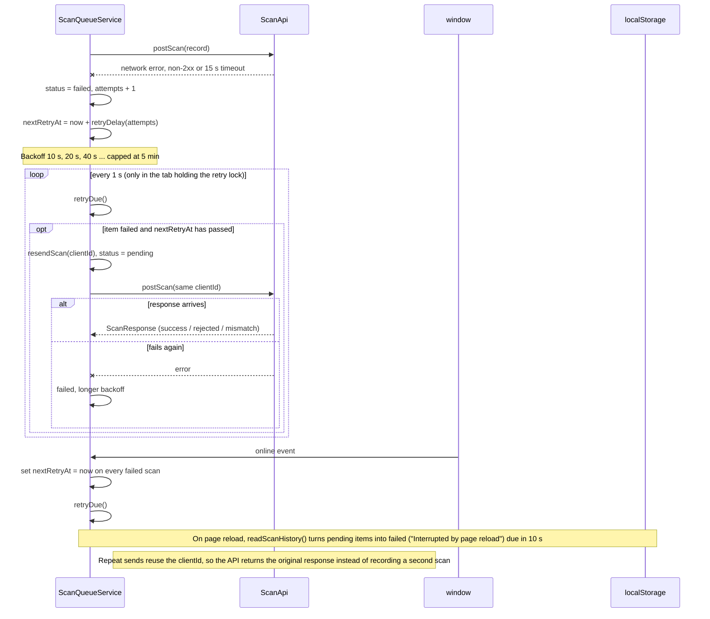
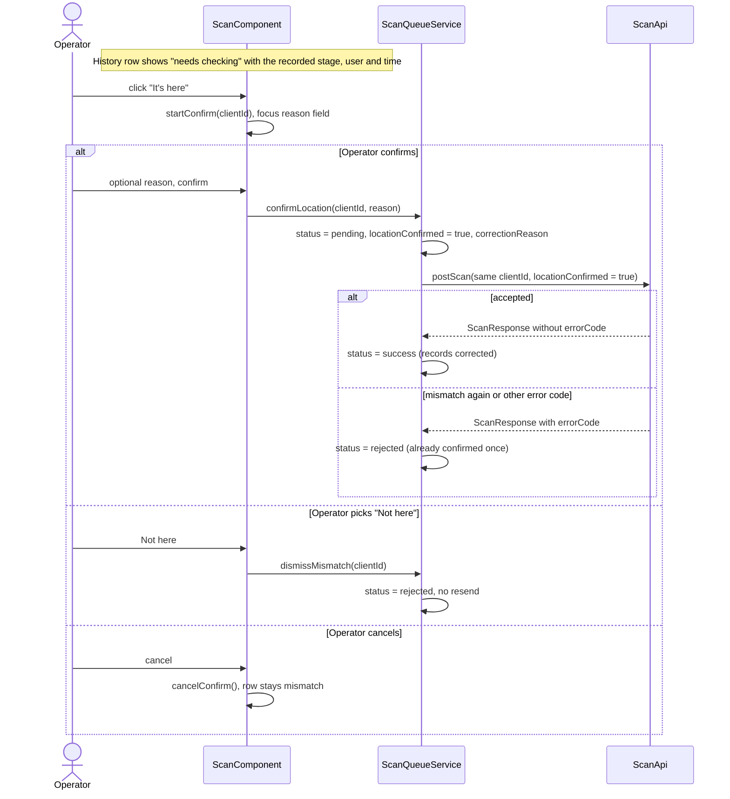
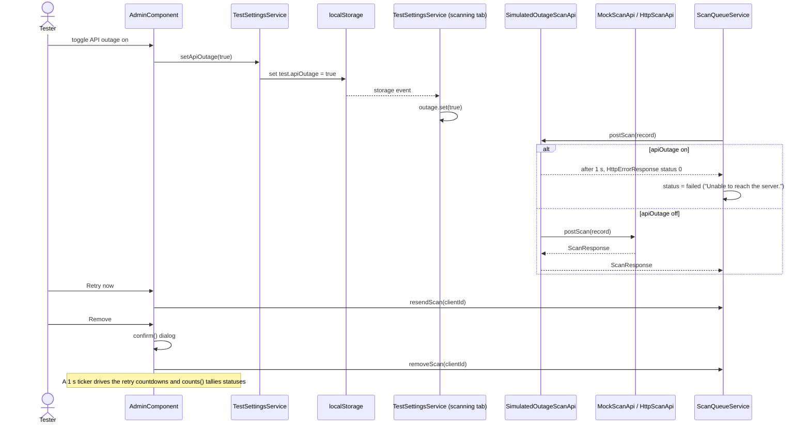
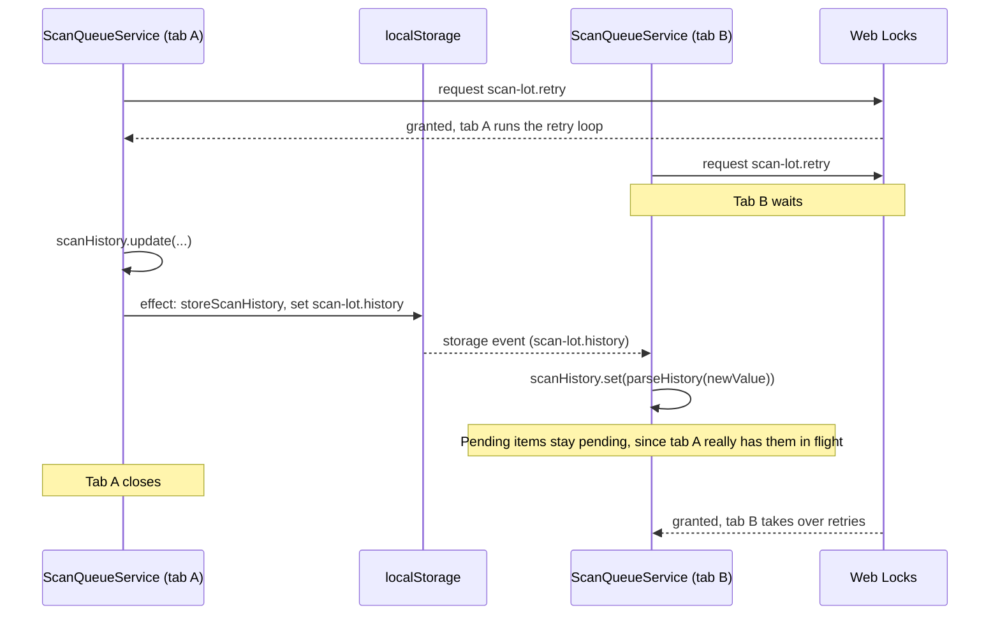

# Sequence Diagrams

Runtime flows of `orthanc-scan-ui`. The participating classes are described in [class-diagram.md](class-diagram.md). `ScanApi` is `HttpScanApi` in production, and in dev builds it is wrapped by `SimulatedOutageScanApi`.

## 1. App load and routing guard

Every child route of `/scan-lot` passes through `scanLotGuard`, which loads the stage catalog first and then decides which screen the URL may show.

## 2. Pick a stage and start a session

## 3. Barcode scan and submit

The scanner sends each barcode wrapped in a delimiter character. The first barcode fills Lot ID, and the second fills Destination and submits the scan.

If no closing delimiter arrives within 300 ms, the keys were typed by hand, and `armBarcodeTimer` inserts them into the focused field.

## 4. Failure and auto-retry

## 5. Resolving a location mismatch

The backend has the lot at another stage. The operator either confirms that the lot really is here, or says it isn't.

## 6. Admin: simulated outage and queue management (dev builds)

## 7. Cross-tab synchronisation

