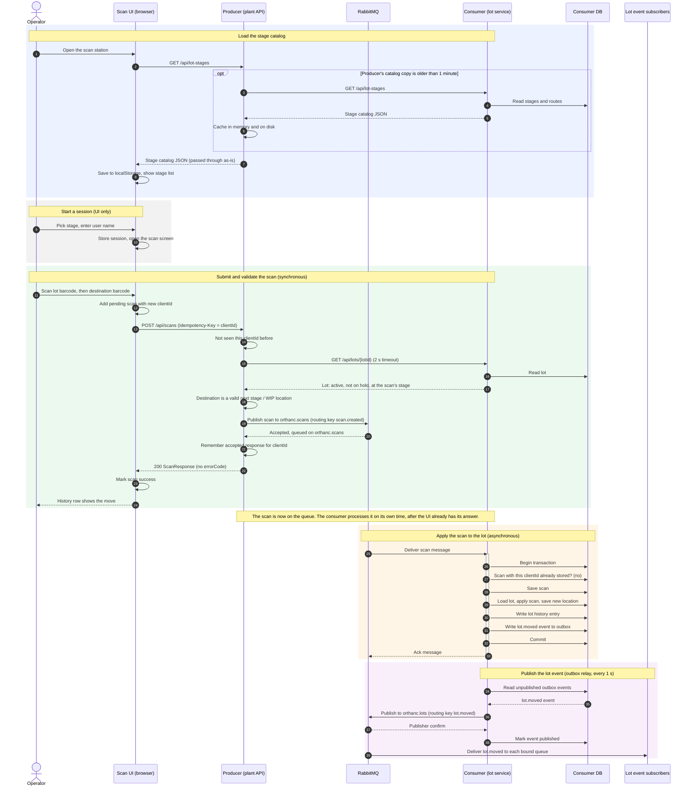

# System Sequence Diagram: Scan Happy Path

How one lot scan travels from the shop-floor UI through `orthanc-scan-producer`, RabbitMQ and `orthanc-scan-consumer`, until the lot's new location is published to other systems. This is the happy path at the process level. For the UI's internal flows (retries, mismatches, outages), see [sequence-diagrams.md](sequence-diagrams.md).

## Notes

- **Sync vs. async boundary.** The operator gets an answer as soon as RabbitMQ accepts the scan (step 20) and the producer replies (step 22). Steps 25 and later happen independently, so the lot's recorded location changes shortly after the UI shows success.
- **Idempotency at every hop.** The UI's `clientId` travels end to end. The producer returns the original response for a repeat `clientId` without publishing again. The consumer skips a redelivered message whose `clientId` is already stored. Lot-event subscribers de-duplicate on the event's `eventId`.
- **Transactional outbox.** The scan, the lot's new location, its history entry and the outgoing `lot.moved` event are committed together. The relay publishes the event only after the commit and marks it published only after the broker confirms, so no event is lost or published for a scan that was rolled back.
- **Event type.** A scan that moves the lot to another stage or WIP location emits `lot.moved`. A scan that leaves it in the same place emits `lot.scanned`.
- **Where the unhappy paths branch off:**
  - The producer can answer with an `errorCode` instead of publishing (steps 17–18): the lot is on hold or not active, the destination is invalid, or `LOT_LOCATION_MISMATCH`.
  - If the consumer lookup fails or its circuit is open, the producer skips the lot checks and publishes anyway, and the consumer flags issues later.
  - If RabbitMQ is down, the publish fails, the UI marks the scan failed and retries it.
  - On the consumer side, a message that keeps failing is retried twice and then dead-lettered to `orthanc.scans.dlq` (reviewable at `/dead-letters`).
